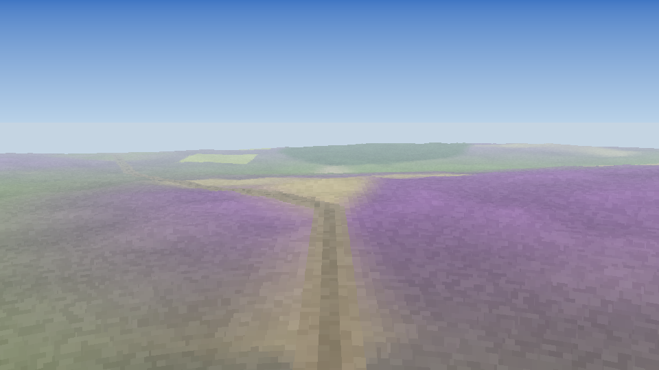

# TIGER — Operation Weißer Blitz

A helicopter combat simulator in the spirit of **Comanche: Operation White Lightning**
(NovaLogic, 1992), built as a web app with an authentic **Voxel Space** engine.
You fly a **Eurocopter Tiger UHT** of the Bundeswehr Heeresflieger over four German
landscapes — Lüneburger Heide, Bayerischer Wald, Schwäbische Alb and the Allgäu at dusk.



## Run

```bash
python3 tools/serve.py
# → http://localhost:8377
```

No build step, no dependencies at runtime. Any static server works; `serve.py`
just sets the right MIME types for the terrain binaries.

## Controls

| Key | Action |
|---|---|
| W/S or ↑/↓ | Cyclic fore/aft (nose down = speed) |
| A/D or ←/→ | Bank & coordinated turn |
| Q/E | Pedal yaw |
| SHIFT / C | Collective up / down |
| SPACE | Fire selected weapon |
| 1 / 2 / 3 | 30 mm cannon / 70 mm rockets / PARS 3 LR |
| F | Flares (breaks SAM locks) |
| V | Chase / cockpit view |
| M | Tactical map (pauses) |
| ENTER | End mission early once primaries are complete |
| ESC | Pause |
| N | Mute |

Land on the **FARP** pad (blue H on the map) to refuel, rearm and repair.
Hold the reticle on a target to get a **PARS 3 lock** (1.1 s), then fire.
SA-8 batteries need 2.8 s of radar lock on you — break it with terrain, flares or speed.

## Campaign

1. **FEUERTAUFTE** — First Contact · Lüneburger Heide: recon BMPs + supply convoy.
2. **EISERNER VORHANG** — Iron Curtain · Bayerischer Wald: SEAD against SA-8 net.
3. **BRÜCKENSCHLAG** — Bridgehead · Schwäbische Alb: drop the gorge bridge, stop 8 T-80s.
4. **WEISSER BLITZ** — White Lightning · Allgäu, dusk: bunker, fuel farm, Mi-28 gunship.

Plus **Free Flight** training. Progress, volumes and ratings persist in localStorage.
Civilian structures are tracked — collateral damage costs your rating.

## Technology

- **Voxel engine** (`js/engine/voxel.js`): the real NovaLogic technique — a 1024²
  heightmap + colormap raycast per screen column, front-to-back. Two passes: the
  terrain march records per-column depth segments, then sprites (pre-rendered voxel
  models) are composited far-to-near with a per-pixel depth test against those
  segments, so terrain occludes vehicles, trees, tracers and smoke correctly —
  including through transparent gaps in sprites. Distance haze, gradient sky, sun,
  pitch/roll, adaptive internal resolution (640–1280 px wide).
- **Asset pipeline** (`tools/gen_terrain.py`, `tools/gen_models.py`, numpy + Pillow):
  fractal terrain per biome with baked hillshade, rivers/gorges, roads, villages,
  forests; 20 voxel models (Tiger UHT with mast sight & PARS canisters, Mi-28, T-80,
  Gepard, SA-8, BMP, Ural, buildings, trees…) rendered to multi-angle sprite sheets
  with a vectorized numpy z-buffer splatter.
- **Audio** (`js/engine/audio.js`): 100 % procedural WebAudio — blade-pass rotor
  thump, turbine whine, wind, weapons, explosions, lock tones, title music.
- **Game**: arcade-sim flight model with hover assist & ground effect, real
  projectiles, proportional-navigation missiles with top-attack profile, radar
  warning receiver, flares, FARP logistics, radio script, debrief ratings.

## Regenerate assets

```bash
python3 tools/gen_terrain.py   # ~10 s
python3 tools/gen_models.py    # ~60 s
```

## QA

```bash
(cd tools && npm install)      # once: puppeteer-core for the browser playtests
node tests/render_test.mjs     # headless engine frames → tests/out/*.png
node tools/screenshot.mjs      # puppeteer playthrough (needs serve.py running)
node tools/flowtest.mjs        # mission flow: win/debrief/next, SAM+flares, FARP,
                               # convoy escape fail, training crash+respawn
```

A tribute to Comanche: Operation White Lightning · NovaLogic 1992.
## Build metadata

- **Prompt**: [prompt.md](prompt.md) — verbatim, one shot.
- **AI coding runtime**: OpenCode v2.2.7 · model **Qwen4-Max-Preview**
  (`qwen-token-plan/qwen4-max-preview`).
- **Built**: November 16th 2026 — one main session plus four subagents
  (UI shell, Python asset pipeline, procedural audio engine, terrain art direction).
- **Token consumption** (OpenCode session accounting at publication, main + subagents):

  | stream | tokens |
  |---|---:|
  | input | 754,477 |
  | output | 236,121 |
  | reasoning | 245,550 |
  | cache reads | 27,020,544 |
  | **total processed** | **28,256,692** |

  Fresh (non-cache) tokens: 1,236,148.
- **QA at publication**: `tests/render_test.mjs` pass; `tools/screenshot.mjs`
  playthrough with zero console errors; `tools/flowtest.mjs` 12/12 mission-flow
  checks (win → debrief → next, SAM + flare decoy, FARP service, convoy escape
  fail, training crash + respawn).
